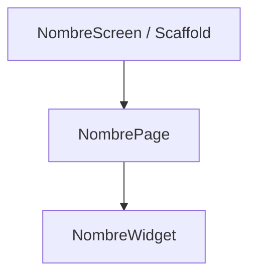
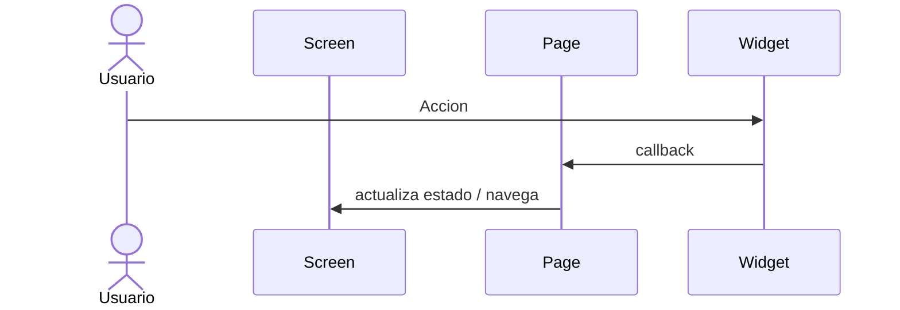

# [PLAN-XXX] Plan Tecnico de Implementacion

## Metadatos
- ID: PLAN-XXX
- Spec asociada: [SPEC-XXX](../specs/<nombre>-spec.md)
- Fecha: YYYY-MM-DD
- Estado: [DRAFT | READY_FOR_TASKS | IN_PROGRESS | COMPLETED]

## Resumen de la Solucion
Descripcion tecnica breve de como se resuelve la spec en Flutter, sin codigo de produccion.

## Reutilizacion Detectada
- Widgets existentes a reutilizar: [`lib/widgets/...`]
- Modelos existentes: [`lib/model/...`]

## Impacto por Capa

### 1. Modelos y Datos (`lib/model/`)
| Archivo | Accion (crear/modificar) | Descripcion |
| :--- | :--- | :--- |
| `lib/model/nombre.dart` | crear | Campos y constructor const |

### 2. Widgets Reutilizables (`lib/widgets/`)
| Widget | Parametros / callbacks | Responsabilidad |
| :--- | :--- | :--- |
| `NombreWidget` | `final String x`, `VoidCallback? onTap` | ... |

### 3. Pages (`lib/pages/`) - sin Scaffold
| Page | Estado propio | Responsabilidad |
| :--- | :--- | :--- |
| `NombrePage` | Stateless / Stateful | Contenido del body |

### 4. Screens (`lib/screens/`) - Scaffold, AppBar, navegacion
| Screen | Page que hospeda | Notas |
| :--- | :--- | :--- |
| `NombreScreen` | `NombrePage` | AppBar, FAB, etc. |

### 5. Rutas y Navegacion (`lib/routes/app_routes.dart`, `lib/main.dart`)
- Rutas nuevas: `/nombre` (argumentos: ...)
- Integracion con `NavigationBar` / `IndexedStack`: [si aplica]

## Gestion de Estado
Donde vive el estado, quien lo eleva y como fluyen los datos y callbacks. Justificacion.

## Diagramas

### Arbol de Widgets

### Flujo de Navegacion o Estado

## Estrategia de Pruebas
| Escenario Gherkin | Prueba | Archivo |
| :--- | :--- | :--- |
| Camino feliz | widget test | `test/...` |

## Calidad y Riesgos
- `flutter analyze` sin advertencias; constructores `const`; sin `print`.
- Decisiones abiertas o dependencias nuevas a confirmar: [...]
