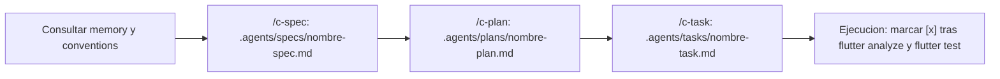

# Portal de Agentes - Seminario de Ingenieria de Software (`seminario_2026_02`)

Este archivo es el **punto de entrada principal (entrypoint)** para los agentes de Inteligencia Artificial (como Antigravity, Cursor, Copilot u otros asistentes autonomos de codificacion) que operan en este repositorio. Proporciona una estructura clara y referencias relativas hacia los componentes clave del sistema de agentes: memoria persistente, convenciones de desarrollo y habilidades operativas.

---

## Mapa de Estructura de Agentes

El directorio [`.agents/`](./.agents/) organiza el conocimiento operativo y las directrices del proyecto en las siguientes areas:

*   **[Habilidades y Skills (`./.agents/skills/`)](./.agents/skills/)**  
    Paquetes de capacidades procedimentales cargadas bajo demanda para auditoria de arquitectura, linter y buenas practicas en Flutter.

*   **[Memoria (`./.agents/memory/`)](./.agents/memory/)**  
    Espacio dedicado al almacenamiento de contexto persistente entre sesiones de trabajo, notas sobre decisiones tomadas, estado evolutivo de tareas y lecciones aprendidas por el agente.

*   **[Convenciones (`./.agents/conventions/`)](./.agents/conventions/)**  
    Espacio reservado para definir los lineamientos arquitectonicos, estandares de codigo para Flutter y Dart, buenas practicas de desarrollo, manejo de estado, pruebas y politicas de control de versiones.

*   **Artefactos del flujo Spec-Driven (`./.agents/specs/`, `./.agents/plans/`, `./.agents/tasks/`)**  
    Carpetas de salida de las skills `/c-spec`, `/c-plan` y `/c-task`. Se crean bajo demanda al generar el primer artefacto. Las plantillas viven dentro de cada skill.

---

## Flujo Spec-Driven (obligatorio para funcionalidades nuevas)

| Skill | Responde | Plantilla | Salida |
| :--- | :--- | :--- | :--- |
| [`/c-spec`](./.agents/skills/c-spec/SKILL.md) | El QUE, agnostico a la tecnologia (HUs, pantallas, Gherkin) | [spec-template](./.agents/skills/c-spec/templates/spec-template.md) | `.agents/specs/<nombre>-spec.md` |
| [`/c-plan`](./.agents/skills/c-plan/SKILL.md) | El COMO en Flutter (Screen/Page/Widget, modelos, rutas, estado), sin codigo de produccion | [plan-template](./.agents/skills/c-plan/templates/plan-template.md) | `.agents/plans/<nombre>-plan.md` |
| [`/c-task`](./.agents/skills/c-task/SKILL.md) | Tareas atomicas con checkboxes `- [ ]` y verificacion | [task-template](./.agents/skills/c-task/templates/task-template.md) | `.agents/tasks/<nombre>-task.md` |

Reglas del flujo:
1. No modificar `lib/` sin una tarea respaldada por plan y spec; cada fase se confirma con el usuario antes de pasar a la siguiente.
2. Una tarea se marca `- [x]` solo tras verificarla con `flutter analyze` y `flutter test` (o la verificacion indicada).
3. Sin emojis en documentacion tecnica ni commits; usar diagramas Mermaid para flujos complejos.

---

## Directrices de Operacion para Agentes

1. **Consulta Previa**: Antes de realizar modificaciones sustanciales o estructurar nuevas funcionalidades, revisa las directrices y reglas establecidas en [convenciones](./.agents/conventions/).
2. **Persistencia y Contexto**: Documenta cualquier decision arquitectonica relevante o hallazgo tecnico en [memoria](./.agents/memory/) para asegurar la continuidad entre sesiones.
3. **Uso de Habilidades**: Invoca o consulta las [habilidades](./.agents/skills/) bajo demanda cuando la tarea requiera revisiones de arquitectura o analisis estatico de codigo.
4. **Respeto a la Estructura**: Manten la separacion de responsabilidades entre el codigo fuente del proyecto (`lib/`, `test/`) y la configuracion operativa de agentes (`.agents/`).
